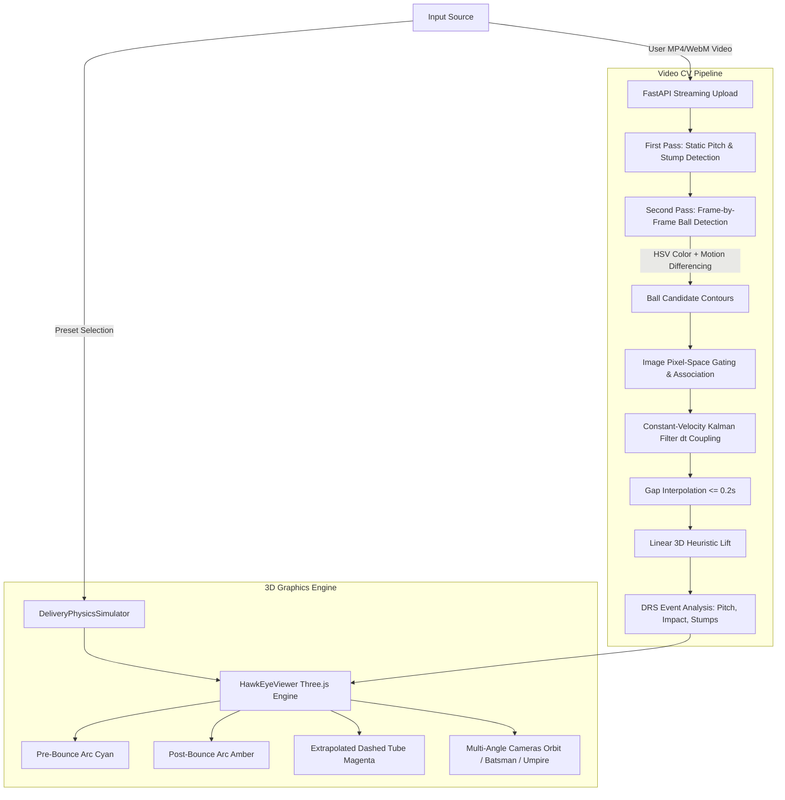

# System Architecture & Pipeline Specification

## 1. System Overview

The Cricket Decision Review System (DRS) & 3D Trajectory Visualization pipeline is partitioned into two clear operational modes:
1. **Interactive Physics Simulation**: Deterministic aerodynamic models (gravity, drag, Magnus force swing, seam deviation, restitution bounce) for educational and review walkthroughs.
2. **Video Computer Vision Pipeline**: Single-camera video analysis combining adaptive color masks, temporal differencing, pixel-space trajectory association, constant-velocity Kalman smoothing, and linear projection.

---

## 2. Coordinate System Conventions

To ensure consistency across CV detection, physics modeling, and Three.js rendering:

### World / Cricket Coordinates (Meters)
- **Origin $(0, 0, 0)$**: Ground center of the pitch $(Y=0)$ between bowling and batting creases.
- **$X$-axis**: Pitch width (cross-pitch, lateral deviation). Positive = Off side (for right-hand batter), Negative = Leg side.
- **$Y$-axis**: Pitch length (bowler to batter). 
  - Bowler release: $Y \approx -10.06\text{ m}$
  - Batter popping crease: $Y \approx +8.90\text{ m}$
  - Batting stumps plane: $Y = +10.06\text{ m}$
  - Total length: $20.12\text{ m}$ ($22\text{ yards}$)
- **$Z$-axis**: Vertical height above the pitch surface. $Z=0$ is ground level. Ball radius $= 0.036\text{ m}$ ($72\text{ mm}$ diameter).

### Three.js Graphics Space
Three.js uses $Y$ as up and $Z$ as depth. HawkEyeViewer maps cricket coordinates via:
$$\text{Three.js } X = X_{\text{cricket}}$$
$$\text{Three.js } Y = Z_{\text{cricket}} \quad (\text{height above pitch})$$
$$\text{Three.js } Z = Y_{\text{cricket}} \quad (\text{distance down pitch})$$

---

## 3. Computer Vision Processing Pipeline

### Stage 1: Static Geometry Analysis
- **Pitch Segmentation**: Samples video frames to detect dominant green grass hue (HSV $35^\circ$–$80^\circ$). Computes convex hull of the bowling strip. Falls back to default geometry if no distinct strip is identified (flagged in `debug_info.geometry_source`).
- **Stump Detection**: Vertical contour search with height-to-width aspect ratio filtering ($\approx 3:1$ to $8:1$). Validates against ICC stump span ($0.2286\text{ m}$) and height ($0.711\text{ m}$).

### Stage 2: Ball Candidate Extraction
- **Color Candidate Mask**: HSV color ranges supporting red balls (including $0^\circ$–$10^\circ$ and $170^\circ$–$180^\circ$ hue wraparound), white balls, and high-visibility pink balls.
- **Motion Differencing**: Absolute frame subtraction against preceding frame ($|I_t - I_{t-1}| > \tau$) to filter static pitch textures and isolate dynamic foreground.
- **Shape Scoring**: Contour circularity ($4\pi A / P^2$) and Hough gradient circle candidates filtered by radius ($3$ to $15\text{ px}$).

### Stage 3: Pixel-Space Temporal Association
- Gating is strictly executed in 2D image coordinates:
  $$\Delta p = \sqrt{(u_t - u_{t-1})^2 + (v_t - v_{t-1})^2}$$
  $$\Delta p_{\text{max}} = \max(\Delta t \cdot v_{\text{max\_px\_per\_sec}}, \text{tolerance}_{\text{px}})$$
- Inconsistent leaps are discarded as false positives.

### Stage 4: Kalman Filter Smoothing
- Constant-velocity transition matrix with variable frame delta $\Delta t$:
  $$F(\Delta t) = \begin{bmatrix} 1 & 0 & 0 & \Delta t & 0 & 0 \\ 0 & 1 & 0 & 0 & \Delta t & 0 \\ 0 & 0 & 1 & 0 & 0 & \Delta t \\ 0 & 0 & 0 & 1 & 0 & 0 \\ 0 & 0 & 0 & 0 & 1 & 0 \\ 0 & 0 & 0 & 0 & 0 & 1 \end{bmatrix}$$
- Real detections update the state via measurement correction. Predicted gap frames update state prediction only without artificial covariance contraction.

---

## 4. DRS Decision Logic

The Decision Review System evaluates the three ICC LBW criteria:
1. **Pitching**: Evaluates the lateral $X$ coordinate of the bounce point against the stump corridor:
   - $|X_{\text{bounce}}| \le 0.1143\text{ m} \implies \text{IN LINE}$
   - $X_{\text{bounce}} > 0.1143\text{ m} \implies \text{OUTSIDE OFF}$
   - $X_{\text{bounce}} < -0.1143\text{ m} \implies \text{OUTSIDE LEG}$ (automatic NOT OUT for LBW)
2. **Impact**: Position of ball at pad impact:
   - In Line if $|X_{\text{impact}}| \le 0.1143\text{ m}$
3. **Wickets**: Extrapolated path at the stump plane ($Y = 10.06\text{ m}$):
   - $\text{HITTING}$ if trajectory intersects within the stump bounding volume ($|X| \le 0.1143\text{ m}$, $0.036\text{ m} \le Z \le 0.711\text{ m}$)
   - $\text{UMPIRE'S CALL}$ if the ball center misses but the ball boundary ($r = 0.036\text{ m}$) touches the outer stump zone
   - $\text{MISSING}$ if the trajectory passes clear over or outside the wickets
