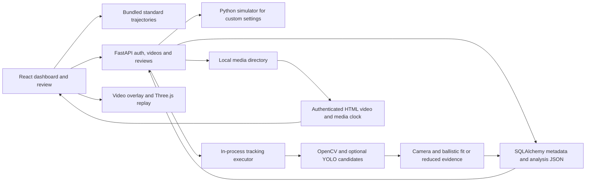

# Crease / Lab project context and roadmap

28 November 2026 · Baseline `200b9f7` on `codex/demo-studio`

This audit describes the original baseline. For completed changes, verification results, and remaining release checks, see the [production readiness plan](plans/2026-11-28-production-readiness.md).

Crease / Lab is an educational cricket replay studio. Its clearest value today is helping students and coaches see how ball flight, bounce, and wicket geometry affect a decision. A second workflow lets someone inspect a delivery from their own footage, see where the software found candidate ball positions, and explore a modeled flight when the camera and track support it. Treat the simulator as the dependable first experience. Pilot uploaded footage with a defined capture setup and judge it by the quality of evidence a reviewer can inspect. Keep the present educational scope for decisions from video.

## What a user can do today

| Workflow | Current behavior | Friction and next opportunity |
| --- | --- | --- |
| Learn from a standard delivery | Launch simulation from the dashboard. Four standard replays run with bundled data and no API. Play, step, scrub, change camera, and watch the decision form. Custom surface and spin variants call the simulator API. | Keep Play and the next evidence event visible. Make custom settings clearly dependent on the server and preserve the last usable standard replay if a custom calculation fails. Introduce comparison only after users understand one replay. |
| Capture or upload | Choose or drop a supported filename extension, or record with a browser camera. The app creates or reuses a guest workspace, stores the clip, queues tracking, and opens the review. The built-in recorder disables audio. | Show a camera placement example and a single-delivery recording guide before capture. Show upload, queue, analysis, and review availability as separate stages. Explain the audio limitation beside Record. |
| Inspect a delivery | Review the source video, scrub, replay slowly, jump or step through candidates, and inspect the track overlay. Split and 3D controls remain available when there is no usable flight, in which case the scene explains the missing reconstruction. The source stays available when tracking returns no ball. | Lead with what was recovered and one next action. Keep Video selected for 2D-only results and explain why 3D is unavailable beside the view controls. For a short or empty track, show the processed window and suggest trimming or rerecording. Offer pitch marking when the track and landmarks can support a refit. |
| Calibrate and assess | Pick or enter four source-frame pitch corners. For eligible clips, the server refits the camera and flight using stored geometry inputs. A reviewer can save an assessment and notes, inspect audio, and use report or export tools. | Teach corner order on the paused frame, give immediate feedback on invalid geometry, and show what improved after applying it. Saved assessments have an API read path, but the current UI only posts them. Add assessment history and link each entry to the analysis revision. |
| Resume or manage clips | The library shows recent clips for the current workspace, with search, reprocess, and delete. A token in browser storage identifies the workspace. | Navigation lives in React state, so refresh drops the selected view. The mounted app offers no path to its existing sign-in component, guest recovery, or account promotion. Provide a direct private review link and a clear choice between temporary and durable access. |

The workflow entry points are the [dashboard](../frontend/src/pages/Dashboard.js), [app shell](../frontend/src/App.js), [review workspace](../frontend/src/pages/DRSReview.js), [account component](../frontend/src/pages/AuthPage.js), [video API](../backend/src/api/videos.py), and [review API](../backend/src/api/reviews.py).

## System map

| Surface | Where to work |
| --- | --- |
| App shell and library | `frontend/src/App.js` switches dashboard and lazy-loaded review, coordinates selected-source requests and polls an open processing clip. `pages/Dashboard.js` handles recording, upload, status, search, and clip actions. `api/client.js` configures Axios and coalesces guest creation within a tab. |
| Replay, graphics and audio | `pages/DRSReview.js` owns source and simulation selection, replay state, evidence presentation, calibration and exports. `components/HawkEyeViewer.js` renders the pitch, cameras, trajectory and effects through React Three Fiber. `mediaClock.js`, `trajectory.js`, `replayMotion.js`, and `wicketReplay.js` provide timing, sampling and deterministic animation. `UltraEdgeVisualizer.js` uses browser audio decoding and `utils/audio.js` for an amplitude envelope and candidate peaks. |
| API and persistence | `backend/run_server.py` exposes `src` on the import path. `src/main.py` registers `/auth`, `/videos`, `/reviews`, `/health` and OpenAPI. `database.py` and `models/` define users, videos, one trajectory per clip, and review sessions. SQLite is the documented local path. The original video is stored on disk. `api/videos.py` handles upload, analysis, progress, reprocessing, calibration, diagnostics, streaming and deletion. |
| Uploaded footage | `_run_tracking_async` passes a detector from `BallTrackingService` to `DeliveryTracker`. The active tracker scans frames for learned and color/motion candidates, estimates camera motion and cuts, links candidates, and keeps original source pixels. `camera_geometry.py` solves candidate cameras from visible pitch or wicket landmarks. `ballistic_fit.py` fits and ranks plausible trajectories. A reduced stump-plane fit can estimate length and height; otherwise the result can remain 2D or empty. |
| Simulation | `sample_generator.py` exposes presets and delegates to `ball_physics_engine.py` for flight, pitch response, and events. `wicket_geometry.py` checks modeled contact with wicket geometry. `scripts/generate_standard_deliveries.py` writes the frontend JSON snapshot for standard deliveries. Update or check that snapshot when simulation outputs change. |
| Verification and supporting material | `backend/tests/` covers ownership, simulation, detector selection, calibration and legacy behavior. `frontend/src/**/*.test.js` covers review states, timing, sampling, audio and report handling. `scripts/audit_ui.cjs` drives a fixture-backed browser. `backend/scripts/evaluate_tracking.py` scores pixel tracks; model training, benchmark, and fixture generation scripts live under `scripts/`. `specs/`, `templates/`, `memory/`, and older audits provide historical intent. The presentation material under `docs/project-report/` is outside the application runtime. |

## Contracts to preserve

- **Evidence provenance.** `pixel_track` contains candidate detections in source pixels. `points` in an upload may contain a fitted path in pitch coordinates. Interpolated positions, reconstructed flight, and projected wickets must be distinguishable in the viewer and exports. Appearance of a candidate does not independently establish that it was the ball. `camera_ballistic_fit`, `stump_plane_fit`, `2d_track_only`, and legacy/manual paths carry different evidence. In particular, stump-plane points use `x = 0`; their length and height estimate does not establish lateral line.
- **Decision provenance.** Simulation verdicts describe modeled events. The current upload API intentionally returns `drs_evaluation` and `impact_point` as null. It can expose a conditional wicket projection from supported camera-fit evidence. User assessments are stored separately. Source audio peaks are inspection cues, and audio offset may be unknown. Preserve the origin and uncertainty in summaries and exports.
- **Coordinates and time.** Pitch coordinates use metres with lateral `x`, down-pitch `y`, and vertical `z`; the Three.js scene maps them to `(x, z, y)`. The SVG overlay maps source pixels into the letterboxed video rectangle. Upload playback follows presented media time when available and the element playhead otherwise. Full duration, decoded processing window, candidate coverage, and inferred physical capture time have different meanings. The simulation runs on its own clock.
- **Ownership and lifecycle.** Each guest currently gets a separate user record. Video and review routes enforce owner checks; standard presets are public. Upload accepts an extension allowlist and a byte limit. The scan uses up to `MAX_PROCESSING_FRAMES` frames from the beginning of the clip (default 300). Processing success can mean source playback with no detectable ball. The API currently uses `uploaded`, `processing`, `processed`, `error`, and `failed`; a future job state model should represent previous usable results through retries.

These contracts are implemented by the [video API mapping](../backend/src/api/videos.py), [delivery tracker](../backend/src/services/delivery_tracker.py), [media clock](../frontend/src/utils/mediaClock.js), [sample interpolation](../frontend/src/utils/trajectory.js), and [audio inspection](../frontend/src/components/UltraEdgeVisualizer.js).

## Findings and prioritized roadmap

Priorities follow release risk and user value. P0 is required before a hosted footage pilot. Work on the simulator and offline validation can continue in parallel. Each item identifies an outcome that another developer can verify.

| Priority | Finding and effect | Implementation and acceptance |
| --- | --- | --- |
| **P0 · Deployment** | The Compose SQL creates `users.username`, while the ORM expects `name` and `updated_at`. Review columns, JSON types, and trajectory uniqueness also differ. Import-time schema creation cannot migrate existing tables, and `/health` stays green when schema setup fails. The root production image references absent nginx and supervisor configs. Compose nginx uses container-local `localhost` for the API, and the frontend environment variable differs from the key the CRA client reads at build time. | Select one supported build and same-origin proxy path. Use versioned migrations and validate the database at readiness time. Smoke-test a clean database and an upgrade, then verify guest creation, upload, seek, refresh, and delete through the actual proxy. Remove or mark alternative deployment paths once the supported path exists. [Compose](../docker-compose.yml) · [SQL](../docker/init.sql) · [Dockerfile](../Dockerfile) · [nginx](../docker/nginx.conf) · [app startup](../backend/src/main.py) |
| **P0 · Session and media privacy** | Development signing defaults are accepted, seven-day JWTs are the local default, and the workspace token travels in playback and thumbnail query strings. Proxy request logs may retain it. Guest creation, password requests and uploads have no app-level rate or quota checks. | Require a deployment secret, remove development seed credentials from hosted setup, and define guest expiry and cleanup. Use same-origin session cookies or short-lived clip-scoped playback credentials. Redact credentials and personal data from logs, set private media cache policy, and apply rate and workspace limits. Verify expiry and ownership across media, calibration, review, and delete. [Config](../backend/src/config.py) · [auth](../backend/src/api/auth.py) · [stream](../backend/src/api/videos.py#L736) · [client](../frontend/src/api/client.js) |
| **P0 · Durable analysis and deletion** | A two-thread local executor limits running work, but accepted jobs and progress are process-local. Restart can strand a clip in `processing`. Reprocess checks status before updating it; the claim is not atomic across workers. Upload completion and deletion cross multiple commits and disk operations. SQLAlchemy models and the local SQLite configuration do not supply a consistent review cascade. | Introduce a persisted job with atomic claiming, a bounded queue, retry/recovery, and generation IDs. Publish the new result and terminal status together, retain the previous successful revision during retry, and coordinate deletion with jobs and storage cleanup. Test restart, duplicate submission, calibration versus reprocess, delete during processing, and partial storage/database failure. [Processing and deletion](../backend/src/api/videos.py) · [storage service](../backend/src/services/video_service.py) · [database](../backend/src/database.py) · [review model](../backend/src/models/review_session.py) |
| **P0 · Media compatibility and resource bounds** | A compatible extension does not guarantee that OpenCV and the target browser can play the same codec. The frame cap starts at frame zero, so a ball late in a valid upload can be missed. Streaming has a handwritten Range handler with limited validation, and source audio inspection downloads and decodes the entire clip on demand. | Define supported codec, duration, resolution and frame limits; enforce ingress size at the proxy and preflight before scheduling. Normalize footage to a browser-tested format if the pilot needs broader inputs. Use a standards-compliant range responder and a size-bounded audio path. Test valid, corrupt, oversized, unsupported, variable-rate and phone-rotated media plus seeking and actionable rejection messages. [Upload/stream](../backend/src/api/videos.py) · [scan](../backend/src/services/delivery_tracker.py#L137) · [audio](../frontend/src/components/UltraEdgeVisualizer.js) |
| **P1 · Evidence quality** | The checked-in real-clip validation documents zero matches within 15 px across nine labeled positions on a post-contact segment, with a cut and an ambiguous bounce. This establishes one failure on that segment. Historical per-frame benchmarks and synthetic fixtures answer different questions from end-to-end uploaded delivery accuracy. | Build a small consented labeled corpus around a fixed behind-bowler setup, then add side-on, handheld, cuts, occlusion, varied lighting and ball colors. Run the active upload pipeline. Report precision/recall, coverage, pixel error, false tracks on negative clips, valid-fit yield, bounce error and wicket-plane error where independently measured. Measure coverage against error before changing thresholds or broadening support. [Demo evidence](../demo_videos/CREDITS.md) · [evaluator](../backend/scripts/evaluate_tracking.py) · [historical benchmark](../TESTING_BENCHMARK_REPORT.md) |
| **P1 · First review and recovery** | The green dashboard gives the standard simulation a clear entry, but the review surface combines core playback, capture evidence, settings, exports, themes and scene effects. “Ready to review” can mean a 2D track, a fit or only source playback. A failed trajectory fetch stops active polling, with recovery depending on the current view. | Make the primary path **Play → inspect a tracked moment → understand what the result supports**. Give the evidence header four clear states: processing, source only, 2D candidates and 3D estimate. Label the processed interval, provide Retry where relevant, and show a recapture or calibration action when it can help. Test the flow with a first-time learner and a coach using a partial-track clip. [Review](../frontend/src/pages/DRSReview.js) · [dashboard](../frontend/src/pages/Dashboard.js) · [selection and polling](../frontend/src/App.js) |
| **P1 · Responsive and accessible review** | Existing strengths include a skip link, named playback buttons, a slider, textual verdicts, a mobile single-view layout, and reduced-motion support. The waveform canvas accepts pointer seeks without a surface-specific keyboard equivalent, and some 3D points are mesh click targets. CSS, the MUI theme, and scene palettes have separate styling responsibilities; the design doc still describes the earlier blue/graphite shell. | Preserve a reachable timeline on phones, expose named event jumps and timestamps via ordinary controls, and give keyboard access to waveform markers and interactive 3D evidence outside the canvas. Consolidate shell tokens across MUI/CSS and document scene-only palettes. Validate keyboard focus after dialogs and view switches, touch targets, browser zoom, reduced motion and screen reader announcements on the main flows. [Styles](../frontend/src/index.css) · [app theme](../frontend/src/App.js) · [waveform](../frontend/src/components/UltraEdgeVisualizer.js#L154) · [3D viewer](../frontend/src/components/HawkEyeViewer.js) · [historical design](DESIGN.md) |
| **P1 · Scoped maintainability** | The tracker is still initialized through the large legacy `BallTrackingService` even though the active path uses `DeliveryTracker`. Closely related upload, track, reprocess and calibration paths each encode persistence rules. Review rendering and exports derive overlapping evidence rules from loose JSON. | Extract detector loading/provenance and a single job/result boundary first. Introduce versioned result schemas and a shared frontend evidence model across the screen and exports. Extract the media controller and evidence inspector around the existing tests. Preserve older JSON reads and the no-verdict contract as acceptance tests. [API](../backend/src/api/videos.py) · [legacy service](../backend/src/services/ball_tracking_service.py) · [review](../frontend/src/pages/DRSReview.js) |
| **P2 · Performance at pilot scale** | A ready library row opens its own video metadata request. The library returns at most 100 entries and search is client-side. Tracking loads a model per run. Replay time updates drive the review tree, and the WebGL canvas preserves its drawing buffer for screenshots. | Profile first replay, mobile scrubbing, thumbnail requests, model initialization, queue wait and per-clip CPU/RAM. Generate small thumbnails, paginate on the server, reuse detector instances per isolated worker, and benchmark narrower time subscriptions and idle rendering. Choose thresholds after recording a baseline on the target hardware. [Library](../frontend/src/pages/Dashboard.js#L399) · [list query](../backend/src/services/video_service.py#L53) · [detector](../backend/src/api/videos.py#L33) · [canvas](../frontend/src/components/HawkEyeViewer.js#L1262) |
| **P2 · Returning-user value** | Refresh loses the selected review, guest expiry can lock users out of clips, and saved assessments are hard to revisit. | Add recoverable workspaces and durable private review links, then display saved notes and review history with evidence revision and export provenance. Evaluate delivery comparisons after interviews show a repeat coaching use case. Defer team sharing until ownership, expiry, and deletion behavior are proven. [Routing](../frontend/src/App.js) · [guest sessions](../backend/src/api/auth.py#L91) · [reviews](../backend/src/api/reviews.py) |

## Release sequence and evidence

1. **Make the baseline repeatable.** Lock runtime dependencies, run frontend and backend suites in CI, run a packaged API smoke test, and add a check that regenerating standard simulation data produces the committed output. Promote the browser harness into repeatable fixture coverage. Update older onboarding commands once the supported setup is established.
2. **Open a private footage pilot after P0.** Exercise the actual deployment with fresh and upgraded databases and two isolated workspaces. Confirm restart recovery and independently verify that deleting a delivery cleans up both metadata and media. Attach reproducible browser and API smoke-test results to the release.
3. **Validate the guided review in parallel.** Pilot a narrow capture setup with learners and coaches. Record time to first replay, completion of the first review, ability to explain candidate versus fit versus projection, rate of usable uploads, and recovery from a partial track. Use aggregate metrics without recording/reporting clip content or filenames. Set numeric targets after the first baseline.
4. **Expand after evidence supports it.** Broaden capture formats, performance capacity and follow-up workflow around measured failure modes and repeat use. Keep automation of real-footage decisions outside the pilot until there is an independently validated way to establish the required contact and geometry evidence.

## Working on the repository

- The local development path in [README](../README.md) starts the SQLite-backed API via `backend/run_server.py` and the CRA frontend via `npm start`. Use the Python environment with `backend/requirements.txt` installed. `config.py` reads process environment, so set backend values explicitly in the shell or the launcher. The CRA client reads `REACT_APP_API_BASE_URL` at build time. For isolated work, use a temporary database and upload directory.
- Run backend tests from `backend` with `python -m pytest tests -q`. Run frontend tests from `frontend` with `npm test -- --watchAll=false --runInBand` and build with `npm run build`. `scripts/audit_ui.cjs` takes a Chromium executable, `docs/ui-audit/fixture.json`, output directory and optional build path. It uses a fixture instead of a live backend. The Makefile's Cypress and lint/format targets need reconciliation with the actual scripts and dependencies.
- For a tracking change, validate the upload route and the evaluator on the same footage. The `--annotated-frames-only` option is useful for sparse real labels. Record source, model, processing configuration and evaluation criteria alongside results. The three tracked `yolov8n.pt` paths point to the same Git blob; consolidate packaging after establishing canonical model provenance and checksums.
- For replay changes, verify the no-track, 2D-only, fitted, and projected states. Check first/last tracked frames, scrubbing/pausing, video-to-3D mode changes and custom versus offline standard simulations. In particular, `sampleTrajectoryAtTime` interpolates between successive samples without a maximum gap. Add a gap/cut-aware policy if evaluating occlusions or displaying bridging lines as continuous evidence.
- The older architecture and audit documents contain useful implementation history. Their statements about a shared guest, default heuristic upload pipeline, entry hierarchy and early test counts should be read against the current code. Start new work here, then use code and fresh tests to check the behavior you are changing.

## Verification at this baseline

- The frontend passed 28 tests across 10 suites. The production build succeeded with a missing dependency source map and a stale Browserslist data warning. Jest also reported an open-handle warning. The build reported about 152 kB gzip for the entry script and about 335 kB total for the two lazy JavaScript chunks. These are build sizes, with device and network performance still to be measured.
- An isolated SQLite API smoke test used the checked-in timing WebM, the installed detector, and a fresh guest. It exercised upload, processing, trajectory retrieval, a byte-range response and deletion. It returned the `2d_track_only` method with no automated verdict. All four bundled standard trajectories matched current simulator output.
- The repository's Python virtual environment is missing SciPy and Ultralytics. The default backend suite stopped during collection on the missing SciPy import. With general geometry excluded, 100 tests passed, four skipped, and one failed on the same missing import. That test passed after loading the installed system SciPy. The complete geometry suite was not verified. The isolated API smoke test used the installed system environment.
- `docker compose config --quiet` accepted the configuration and warned about the obsolete `version` key. Deployment findings are from examining the packaging, proxy and schema. A container build and deployed workflow still need verification.
- Desktop visual review used the existing entry and uploaded-review captures. The fresh Chromium harness did not complete because navigation to its local fixture server timed out. Responsive behavior on real devices, live camera permissions, a hosted deployment, and real-footage reconstruction accuracy require separate verification.
